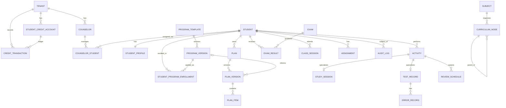

# PHASE 2 DRAFT — Database & Domain Model

Status: **DRAFT — NOT COMMITTED, NOT REVIEWED, NOT APPROVED.**
Source: Issue #7 (Phase 2 authorization), `DATABASE.md` (conceptual model), D-008, D-012, D-014, D-020, D-023, Q-007, Q-023.
Verification: design only. No migration, schema, or test has been created or executed. Nothing here is runtime evidence.

---

## 1. Scope of this draft

In scope: domain entities, tenant ownership, keys and constraints, nullability, deletion/lifecycle, indexes (key ones), versioning for `ProgramTemplate`/`ProgramVersion` and `Plan`/`PlanVersion`, the `StudentCredit`/`CreditTransaction` ledger, and test specifications.

Out of scope: migrations, Alembic, runtime infrastructure, authentication, payment gateway, Phase 3+ work, real student data (D-014).

---

## 2. Tenant model

- **Tenant = one Counselor account.** `tenants` is the root. Every tenant-owned table carries `tenant_id UUID NOT NULL`.
- **Composite foreign keys.** Any child row referencing a tenant-owned parent uses `(tenant_id, parent_id)` referencing `parent(tenant_id, id)`. This makes a cross-tenant reference impossible at the database level, not only in application code.
- **Cell boundary (D-020/D-023).** `tenant_id` is not the isolation boundary. Each tenant lives in its own database within a cell, with a tenant-specific credential. This draft does not change that topology.
- **Platform catalog out of MVP (D-012).** `program_templates` and `program_versions` have `tenant_id NOT NULL`. There are no nullable-tenant or shared catalog rows.
- **Server-side tenant resolution.** Tenant ID comes from the trusted membership, never from request input.

---

## 3. ERD (core entities)

Entities with a `tenant_id` column (all of them except `TENANT`) are tenant-owned. `PARENT` and `PARENT_STUDENT_LINK` are intentionally left out of the ERD until Q-007 is resolved (see §10).

---

## 4. Entity specifications

Notation: PK = primary key; FK = foreign key; UQ = unique; CK = check constraint; `tenant_id` is `NOT NULL` on every row unless marked.

### 4.1 Identity and tenancy

| Table | Key columns | Constraints | Deletion / lifecycle |
|---|---|---|---|
| `tenants` | `id` PK, `status` | status enum | Soft (suspended/closed). Never hard-deleted while data exists. |
| `counselors` | `id` PK, `tenant_id` FK, `user_id` FK→users | UQ(`tenant_id`,`id`); UQ(`user_id`) | Soft (`deactivated_at`). |
| `students` | `id` PK, `tenant_id` FK, `user_id` FK→users NULL | UQ(`tenant_id`,`id`) | Soft (`archived`). `user_id` NULL until the student activates an account. |
| `counselor_students` | `id` PK, `tenant_id`, `counselor_id`, `student_id` | FK(`tenant_id`,`counselor_id`)→counselors; FK(`tenant_id`,`student_id`)→students; UQ(`tenant_id`,`student_id`) WHERE status='active' (partial unique); CK status IN (active, paused, archived, ended); CK `ended_at IS NULL OR ended_at >= started_at` | Status transitions only; history preserved. Rows are not deleted. |

Note on `users`: identity table outside the tenant scope (no `tenant_id`). Its design belongs to Phase 4 (Auth/RBAC). Phase 2 only references it through nullable FKs.

### 4.2 Student profile and curriculum

| Table | Key columns | Constraints | Lifecycle |
|---|---|---|---|
| `student_profiles` | `student_id` PK+FK, `tenant_id` | FK(`tenant_id`,`student_id`); most profile fields nullable (not known at intake) | Updated in place; changes audited. |
| `subjects` | `id`, `tenant_id`, `name`, `category`, `importance`, `is_active`, `sort_order` | UQ(`tenant_id`,`name`) among active rows | Deactivate, not delete (referenced by history). |
| `curriculum_nodes` | `id`, `tenant_id`, `subject_id`, `parent_id` NULL, `level` (grade/book/chapter/topic/subtopic), `name` | FK(`tenant_id`,`subject_id`); self FK(`tenant_id`,`parent_id`) NULL; CK level enum | Soft (`is_active`). |

### 4.3 Programs (versioned, D-008 / D-012)

**`program_templates`**
- Columns: `id` PK, `tenant_id NOT NULL`, `name`, `status` (draft/active/archived), `created_by`, `created_at`.
- Stable identity; outlives every version.
- UQ(`tenant_id`,`id`) for composite references.
- Archived, never hard-deleted once any version exists.

**`program_versions`**
- Columns: `id` PK, `tenant_id NOT NULL`, `program_template_id`, `version_number INT NOT NULL`, `status` (draft/published/superseded), `payload_json` (immutable snapshot of subjects, weekly rules, study/review/test rules), `created_by`, `created_at`, `published_by`, `published_at`.
- FK(`tenant_id`,`program_template_id`) → `program_templates(tenant_id,id)`. This is the composite FK required by D-012 point 2.
- UQ(`tenant_id`,`program_template_id`,`version_number`).
- CK: `published_at IS NOT NULL` when `status` ∈ {published, superseded}.
- **Immutability after publish:** no UPDATE to `payload_json`, `version_number`, `published_at`, or `program_template_id`. Enforced at the application layer and by a DB trigger that rejects updates to published rows (the trigger is a Phase 2 test specification, not yet implemented). Only `status` may change, published → superseded.
- Edits create a new `draft` row with `version_number = max + 1`.

**`student_program_enrollments`**
- Columns: `id`, `tenant_id`, `student_id`, `program_version_id`, `enrolled_by`, `enrolled_at`, `ended_at` NULL.
- FK(`tenant_id`,`student_id`)→students; FK(`tenant_id`,`program_version_id`)→program_versions.
- Enrollment references a **specific version**, not the template. A later template version does not change existing enrollments; the counselor must explicitly move the student to a new version (see §5.3).

**`market_segments` and `program_template_segments`** — tenant-owned, same composite FK pattern. Details deferred; they are not needed for the core versioning or ledger invariants.

### 4.4 Planning (versioned, D-008)

**`plans`** (student study plan; not the billing plan — see D-006)
- Columns: `id`, `tenant_id`, `student_id`, `scope` (daily/weekly/monthly/exam/review/recovery), `period_start`, `period_end`, `created_by`, `created_at`.
- FK(`tenant_id`,`student_id`)→students.
- CK `period_end >= period_start`.
- Stable identity across versions.

**`plan_versions`**
- Columns: `id`, `tenant_id`, `plan_id`, `version_number`, `program_version_id` NULL (the version that informed this plan, if any), `created_by`, `created_at`, `activated_at` NULL, `superseded_at` NULL.
- FK(`tenant_id`,`plan_id`)→plans; FK(`tenant_id`,`program_version_id`)→program_versions NULL.
- UQ(`tenant_id`,`plan_id`,`version_number`).
- Partial unique: at most one active version per plan (`activated_at IS NOT NULL AND superseded_at IS NULL`).
- Immutability: content of a version is never updated after activation. Changes produce a new version.

**`plan_items`**
- Columns: `id`, `tenant_id`, `plan_version_id`, `activity_type`, `subject_id` NULL, `curriculum_node_id` NULL, `scheduled_start`, `scheduled_end`, `rationale_json` (explainability, §68).
- FK(`tenant_id`,`plan_version_id`)→plan_versions. Subject and curriculum FKs are composite as well.
- CK `scheduled_end > scheduled_start`.
- Plan items inherit immutability from their version.

### 4.5 Activities and records (§21–§28)

Design choice (proposed, see §10 open decision O-4): a **single `activities` base table** with a `type` enum and **one-to-one type tables** (`study_sessions`, `test_records`, `exam_results`, `class_sessions`, `assignments`). This avoids a polymorphic table with many nullable columns and keeps type-specific constraints enforceable.

- `activities`: `id`, `tenant_id`, `student_id`, `type`, `subject_id` NULL, `curriculum_node_id` NULL, `occurred_on`, `created_at`. FK(`tenant_id`,`student_id`). Index (`tenant_id`,`student_id`,`occurred_on`).
- `study_sessions`: `activity_id` PK+FK, `tenant_id`, `started_at`, `ended_at`, `duration_minutes` (derived or checked against start/end), `goal`, `result`, `mastery_before`, `mastery_after` (0–100, nullable). CK `ended_at > started_at`.
- `test_records`: `activity_id` PK+FK, `tenant_id`, `question_count`, `correct`, `wrong`, `unanswered`, `duration_minutes`. CK: `correct >= 0 AND wrong >= 0 AND unanswered >= 0`; CK `correct + wrong + unanswered = question_count` (per §23; an explicit override flag is a separate open item, O-5).
- `error_records`: `id`, `tenant_id`, `test_record_id` FK(`tenant_id`,…), `error_type` enum with `custom` text for user-defined types. Index (`tenant_id`,`error_type`,`created_at`) for pattern queries.
- `review_schedules`: `id`, `tenant_id`, `original_activity_id`, `review_offset_days` (1/3/7/…), `review_date`, `method`, `mastery_before/after`, `result`. **UQ(`tenant_id`,`original_activity_id`,`review_offset_days`)** — the DB-level duplicate-prevention rule required by DATABASE.md.
- `exams`, `exam_results` (per subject), `class_sessions`, `assignments`: tenant-owned, composite FKs, status enums per §27, lifecycle soft-only.

### 4.6 Billing and credits (§10, §45) — ledger design

**`student_credit_accounts`**
- `tenant_id` PK, `balance INT NOT NULL`, `updated_at`, `version INT` (optimistic lock).
- CK `balance >= 0`.
- The balance is a **cache** of the ledger sum, maintained in the same DB transaction as each ledger insert. It is never written independently.

**`credit_transactions`** (append-only)
- Columns: `id`, `tenant_id NOT NULL`, `amount INT NOT NULL`, `kind` (purchase, activation_consume, refund, cancellation_release, adjustment), `student_id` NULL, `order_id` NULL, `idempotency_key TEXT NOT NULL`, `actor_id`, `reason`, `created_at`.
- CK `amount <> 0`; CK sign rule per kind (purchase/refund/cancellation_release > 0; activation_consume < 0; adjustment non-zero either sign with `reason` NOT NULL).
- **UQ(`tenant_id`,`idempotency_key`)** — duplicate submissions and webhook replays cannot double-apply.
- App-layer grants: INSERT and SELECT only. No UPDATE, no DELETE. Corrections are new compensating rows.

**Invariants (must hold in every committed state):**
1. `student_credit_accounts.balance = SUM(credit_transactions.amount)` for the tenant.
2. `balance >= 0`.
3. Each student activation consumes exactly one credit, in one transaction with the student creation, or the whole operation is rejected (Master Prompt §12).
4. Activation and cancellation are idempotent per `idempotency_key`.
5. A `purchase` is recorded only after provider confirmation; Phase 2 models the state, not the gateway (Phase 22).

**Concurrency:** activation takes `SELECT … FOR UPDATE` on the tenant's credit account row, then checks balance, inserts the ledger row, and updates the balance. Two concurrent activations cannot both pass with one remaining credit.

### 4.7 Audit

**`audit_logs`**: `id`, `tenant_id` NULL (only for platform-level actions), `actor_id`, `action`, `entity_type`, `entity_id`, `before_json` NULL, `after_json` NULL, `created_at`. Append-only, no UPDATE or DELETE grants. Retention is open (Q-020).

---

## 5. Versioning rules (summary)

1. **Template edit** → new `program_versions` row in `draft`; publish → `published`; previous published → `superseded`. Old rows are never rewritten.
2. **Existing enrollments do not change** when a template changes. Moving a student to a new version is an explicit action that creates a new enrollment row and ends the old one.
3. **Plan edit** → new `plan_versions` row. The previous version is superseded and kept. `plan_versions.program_version_id` records the origin.
4. **Explainability:** "What was planned, what changed, why, what happened" is answered by joining `plan_versions` → `plan_items` → `activities` and the `rationale_json`.

---

## 6. Indexes (key ones)

- Every tenant-owned table: index leading with `tenant_id`.
- `counselor_students`: partial unique on `(tenant_id, student_id) WHERE status='active'`.
- `activities`: `(tenant_id, student_id, occurred_on)`.
- `credit_transactions`: `(tenant_id, created_at)`; UQ `(tenant_id, idempotency_key)`.
- `review_schedules`: UQ `(tenant_id, original_activity_id, review_offset_days)`; `(tenant_id, review_date)` for the daily queue.
- `plan_versions`: UQ `(tenant_id, plan_id, version_number)`; partial unique for one active version.
- Dashboard/list queries (counselor filters in Master Prompt §34) need an index review once real query shapes are fixed. Not done in this draft.

---

## 7. Deletion and retention summary

| Data | Policy |
|---|---|
| Tenant data | Soft-close; no hard delete while in retention. Retention duration is open (Q-020). |
| Students, counselor relations | Status change; never hard-deleted if records exist. |
| Program/Plan versions | Never deleted once published. |
| Credit ledger, audit log | Append-only; never deleted by application. |
| Activities and records | Soft-delete only where reporting value exists. |

---

## 8. Test specifications (Phase 2, NOT implemented, NOT executed)

Each is a contract for later implementation. None is PASS.

- **T2-TI-01** Composite FK rejects a `counselor_students` row whose `counselor_id` belongs to another tenant.
- **T2-TI-02** Composite FK rejects a `student_program_enrollments` row referencing a `program_version` of another tenant.
- **T2-TI-03** Composite FK rejects a `plan_versions` row whose `program_version_id` belongs to another tenant.
- **T2-TI-04** Every tenant-owned table rejects `tenant_id = NULL`.
- **T2-VER-01** Published `program_versions` payload cannot be updated.
- **T2-VER-02** `(tenant_id, program_template_id, version_number)` uniqueness holds under concurrent publish.
- **T2-VER-03** Changing a template does not alter existing enrollments.
- **T2-VER-04** At most one active `plan_versions` row per plan.
- **T2-CR-01** Ledger insert with `amount = 0` is rejected.
- **T2-CR-02** Duplicate `idempotency_key` does not double-apply.
- **T2-CR-03** Activation with balance 0 is rejected and no student row is created.
- **T2-CR-04** Two concurrent activations with balance 1 → exactly one succeeds.
- **T2-CR-05** `balance = SUM(ledger)` after a random sequence of operations (property test).
- **T2-CR-06** `balance < 0` is rejected at the DB level.
- **T2-CR-07** UPDATE and DELETE on `credit_transactions` and `audit_logs` are denied for the application role.
- **T2-TEST-01** `correct + wrong + unanswered = question_count` is enforced; the override path is separately specified after O-5.
- **T2-REV-01** Duplicate review generation for the same activity and offset is rejected.

All of the above use **synthetic data only** (D-014).

---

## 9. Phase 2 gates and dependencies

- Phase 2 does not satisfy Q-023. Hosting remains blocked until Q-023 is closed.
- Phase 2 does not unblock real student data (D-014).
- Phase 2 is not approved until independent review. This draft is not an approval.

---

## 10. Open decisions and dependencies

| ID | Question | Why it matters | Recommended option | Alternatives | Impact |
|---|---|---|---|---|---|
| **Q-007** | Parent access model (default level, visible fields, counselor-note visibility) | `parent_student_links` access columns and the query surface depend on it | Leave `parent_student_links` out of Phase 2 until resolved, or model link only with no access grants | Product Owner specifies the access matrix now | **BLOCKED** for the parent access portion only; everything else proceeds |
| O-1 | Confirm tenant = one Counselor account (1:1) | Determines whether `tenants` and `counselors` can merge | Keep separate (room for multi-user counselor offices later) | Merge into one table | Low |
| O-2 | Credit balance: cached column vs derived only | Affects concurrency design | Cached column maintained in-transaction, reconciled by the invariant test | Derived only (simpler, slower under load) | Medium |
| O-3 | Activation: consume immediately vs reserve | Affects failed-creation behavior | Consume in the same transaction as student creation | Two-phase reserve/confirm | Medium |
| O-4 | Activity: single base table + type tables vs polymorphic single table | Constraint enforcement and query shape | Base + type tables (as drafted) | Single table with nullable columns | Medium |
| O-5 | Can a test record override `correct+wrong+unanswered = question_count`? | DATABASE.md allows override only if "explicitly configured" | Override as an explicit flag with reason; default strict | Always strict | Low |
| O-6 | Template update vs existing plans | Product behavior | Explicit re-enrollment only (as drafted) | Automatic propagation to draft plans | Medium (product) |
| O-7 | D-006: rename commercial `Plan` to `BillingPlan` | Naming collision | Approve D-006 | Keep both as `plan` with schema prefixes | Low |
| O-8 | Retention duration and responsible persons (Q-020) | Deletion/retention schema | Defer to pre-pilot gate | — | Low for Phase 2 |

---

## 11. Risks and technical debt

- The DDL is not written. Column types, exact enums, and index choices are provisional.
- The payload snapshot of `program_versions` is a JSON blob. This is simpler but makes querying weak rules harder; a normalized alternative needs a decision.
- The append-only controls are an application grant plus a trigger spec. Against a DB owner or host compromise they are not sufficient; that residual is covered by the Alt-5 cell model, not by this draft.
- Nothing in this draft is executed or verified.

---

## 12. Required next steps (when GitHub write access is available)

1. Create branch `docs/phase2-database-domain-model` from `main`.
2. Commit this draft as `docs/PHASE2_DOMAIN_MODEL.md` (or the agreed path).
3. Update `DATABASE.md`, `DECISION_LOG.md` (O-1 to O-8 as proposals), `OPEN_QUESTIONS.md` (Q-007 dependency), `TEST_PLAN.md` (T2 specifications), `PROJECT_STATE.md`, `CHANGELOG.md`.
4. Open a PR for independent review. Do not merge it and do not declare Phase 2 approved.

---

## 13. Execution status (added in this revision)

- DDL draft `docs/phase2/schema/phase2_schema_draft.sql` was applied to a fresh PostgreSQL 16 database with `ON_ERROR_STOP=1`. It loads without error.
- Constraint suite `docs/phase2/schema/phase2_constraint_tests.sql` ran once on a fresh database: **32 PASS, 0 FAIL, exit 0**. Evidence: `docs/phase2/evidence/test_run_2026-10-25.txt`.
- Rules verified by execution: composite cross-tenant FKs (T2-TI-01/02/03/05), NULL tenant rejection, published-version immutability and transition rules (T2-VER-01), duplicate version numbers, at most one active plan version, test-record sum rule, review duplicate prevention, ledger zero-amount, sign rules, idempotency uniqueness, non-negative balance, append-only ledger and audit log, and role-level denial of UPDATE/DELETE for a runtime role.
- **Not executed:** T2-CR-04 (concurrent activation), T2-CR-03 (end-to-end activation rollback), property-based balance reconciliation (T2-CR-05 beyond one case), T2-VER-02 under concurrent publish, and every application/API-level authorization test. These remain specifications.
- Execution is local and synthetic. It is **not** runtime security evidence for Alt-5 cells, RLS, or hosting. Q-023 and D-014 gates are unchanged.
- Added open decision **O-9 (proposed):** one active `student_program_enrollments` row per student at a time. Implemented as a partial unique index in the draft; requires Product Owner confirmation.
- Phase 2 is **not approved**. Independent review is pending.
